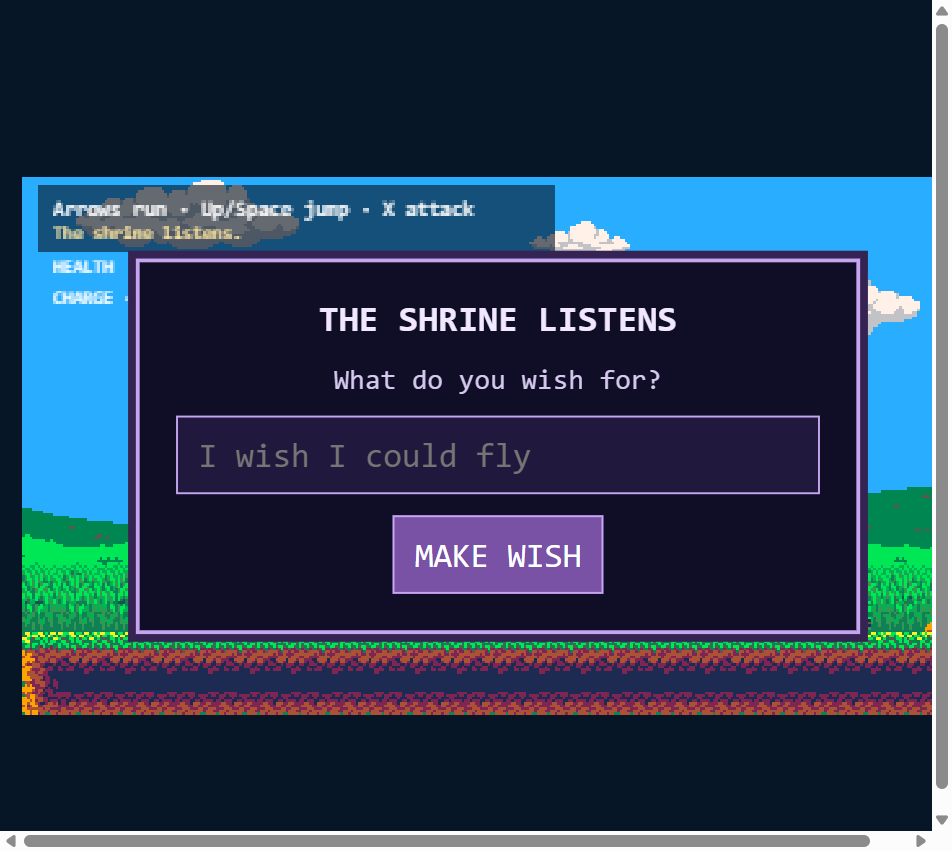
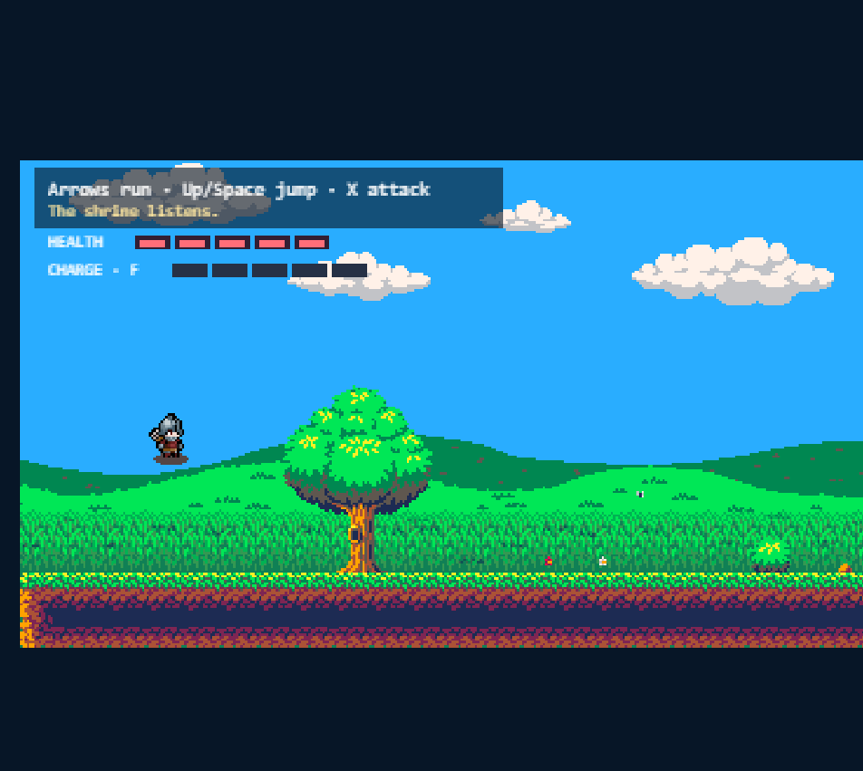

# Wishbound

Type a wish. Walk through a portal. The next world changes.

Wishbound is a small pixel-art platformer made for DevDay Exchange Community Hackathon: Kochi. Level 1 is handcrafted. After the wish, OpenAI generates the next outdoor route, a dungeon, an encounter, a short narration, and a wish-themed hero image. The game engine still controls all movement, combat, physics, health, and validation.





## What It Does

- Player makes a natural-language wish.
- AI builds a safe Level 2 outdoor map and one linked dungeon.
- AI chooses a safe power preset, such as fast car, parachute fall, jetpack dash, armor, or heavy attack.
- AI generates one transparent pixel-art hero image for Level 2 onward.
- Dungeon ends with Orc waves or one giant Orc boss.
- The exit portal unlocks only after the encounter is cleared.

## Controls

- Move: Arrow keys
- Jump: Up or Space
- Attack: X
- Heal: F
- Air dash, when granted: C

## Run Locally

```bash
npm install
cp .env.example .env
npm run server
npm run dev
```

Add your `OPENAI_API_KEY` in `.env` for live wishes, generated maps, dungeons, and hero images.

Useful commands:

```bash
npm test
npm run build
npm run start
```

## Deploy

Use Render as one Web Service.

- Build command: `npm install && npm run build`
- Start command: `npm run start`
- Runtime: Node
- Environment variables:
  - `OPENAI_API_KEY`
  - `OPENAI_MODEL`
  - `OPENAI_MAP_MODEL`
  - `OPENAI_IMAGE_MODEL=gpt-image-1`
  - `NODE_VERSION=24`

## Tech

- Vite
- TypeScript
- Phaser 4
- Node server
- OpenAI Responses API
- OpenAI Images API

## Safety

AI output is validated JSON only. It cannot send code, asset paths, physics values, damage values, or raw tile frames. If generation fails, the game falls back to a tested route.

## Docs

- [Submission](SUBMISSION.md)
- [Architecture](docs/ARCHITECTURE.md)
- [Assets](docs/ASSETS.md)
- [AI usage](AI_USAGE.md)
- [Changelog](CHANGELOG.md)
