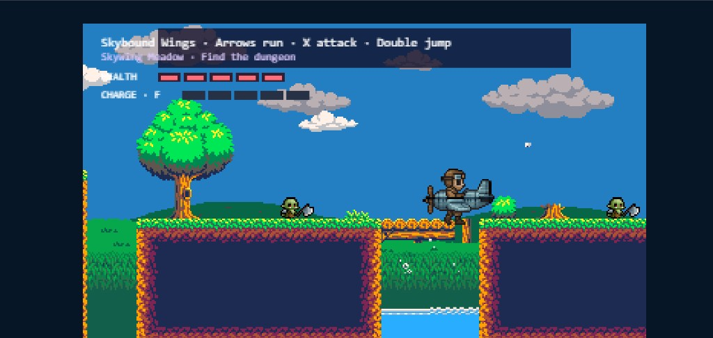
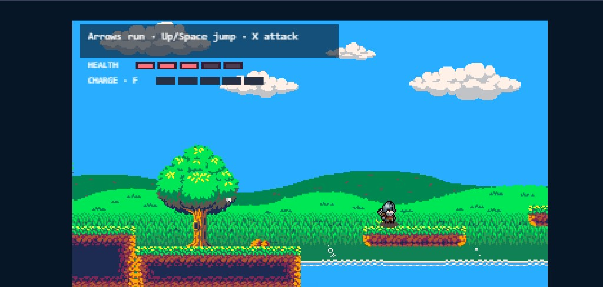
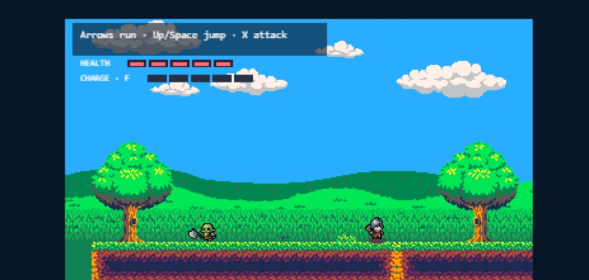

# Wishbound

**Live demo:** [https://wishbound-vuhq.onrender.com/](https://wishbound-vuhq.onrender.com/)

Type a wish. Walk through a portal. The next world changes.

Wishbound is a small pixel-art platformer made for DevDay Exchange Community Hackathon: Kochi. After you make a wish, **OpenAI builds both playable levels completely from scratch** — a full outdoor route and a linked dungeon — including terrain, scenery, enemies, portals, encounter type, short narration, a safe power preset, and a wish-themed hero image. Phaser still owns movement, combat, physics, health, and validation. Nothing the model returns can change those rules.







## What It Does

- Player makes a natural-language wish.
- AI authors two levels from scratch: the outdoor map and the dungeon.
- Outdoor includes platforms, water, bridges, trees, flowers, clouds, enemies, and the dungeon entrance.
- Dungeon includes stone rooms, torches, and either Orc waves or one giant Orc boss.
- AI chooses a safe power preset, such as fast run, double jump, air dash, slow fall, armor, or heavy attack.
- AI generates one transparent pixel-art hero image for the wish-built stages.
- The exit portal unlocks only after the encounter is cleared.
- Looping electro-pop BGM starts after you continue past the controls card.

## Controls

- Move: Arrow keys
- Jump: Up or Space
- Attack: X
- Heal: F
- Air dash, when granted: C

## Run Locally

```bash
npm install
cp .env.example .env
npm run server
npm run dev
```

Add your `OPENAI_API_KEY` in `.env` for live wishes, generated maps, dungeons, and hero images.

Useful commands:

```bash
npm test
npm run build
npm run start
```

## Deploy

Use Render as one Web Service.

- Build command: `npm install && npm run build`
- Start command: `npm run start`
- Runtime: Node
- Environment variables:
  - `OPENAI_API_KEY`
  - `OPENAI_MODEL`
  - `OPENAI_MAP_MODEL`
  - `OPENAI_IMAGE_MODEL=gpt-image-1`
  - `NODE_VERSION=24`

## Tech

- Vite
- TypeScript
- Phaser 4
- Node server
- OpenAI Responses API
- OpenAI Images API

## Safety

AI output is validated JSON only. It cannot send code, asset paths, physics values, damage values, or raw tile frames. If generation fails, the game falls back to a tested route.

## Docs

- [Submission](SUBMISSION.md)
- [Architecture](docs/ARCHITECTURE.md)
- [Assets](docs/ASSETS.md)
- [AI usage](AI_USAGE.md)
- [Changelog](CHANGELOG.md)
